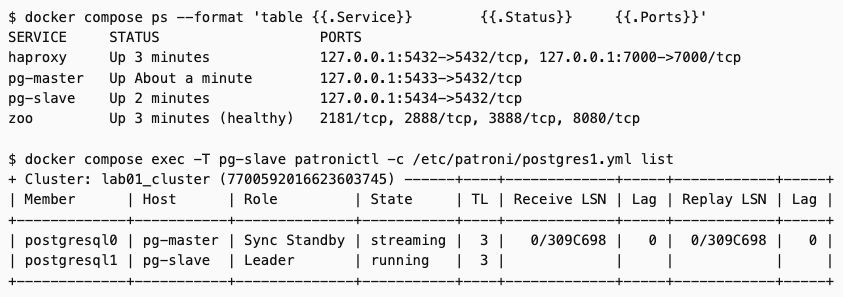
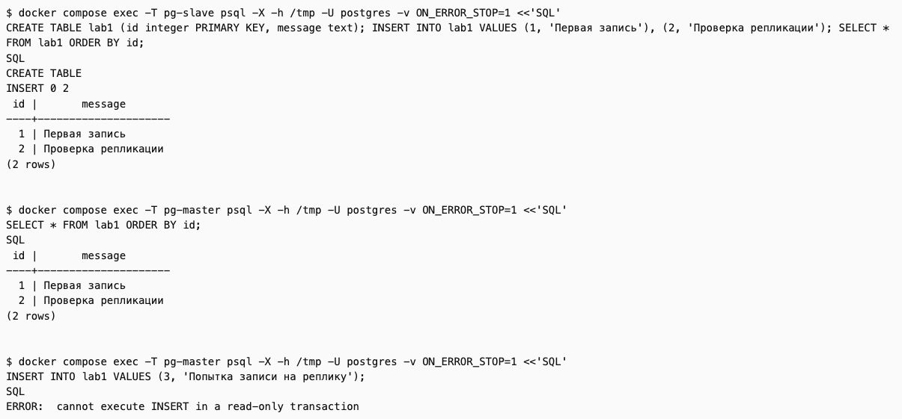
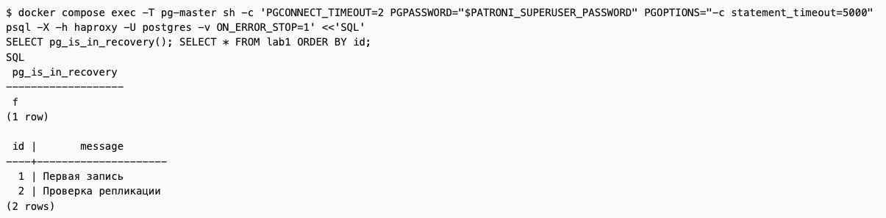
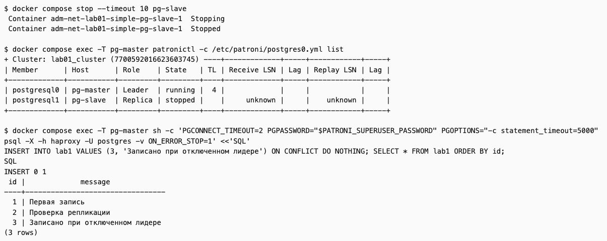
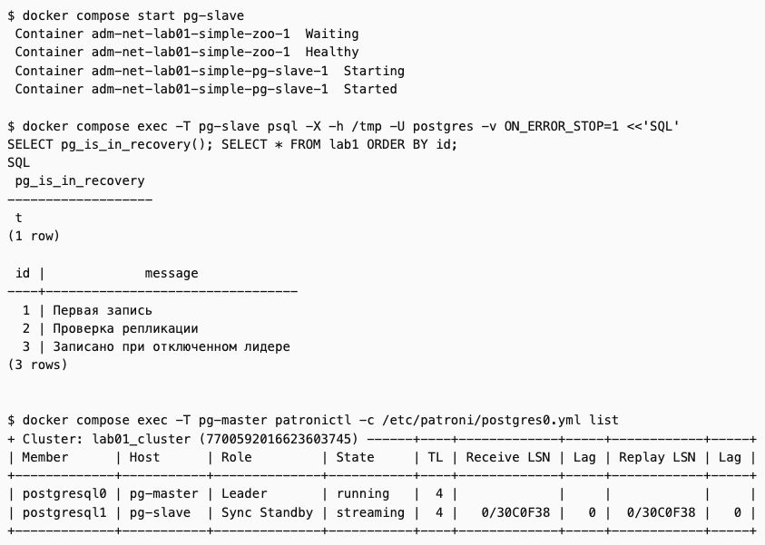
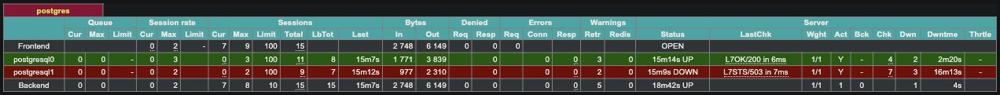

# Лабораторная работа № 1. HA Postgres Cluster

**Выполнил:** Альмухаметов Г.Р., группа K3360

## Цель работы

Развернуть кластер PostgreSQL с помощью Patroni, ZooKeeper и HAProxy. Проверить репликацию, переключение при отключении ведущего узла и получение пропущенных данных после его возвращения.

## 1. Подготовка файлов

Для работы подготовлены пять файлов: [Dockerfile](Dockerfile), [docker-compose.yml](docker-compose.yml), [postgres0.yml](postgres0.yml), [postgres1.yml](postgres1.yml) и [haproxy.cfg](haproxy.cfg).

В Dockerfile используется PostgreSQL 15. В этот же образ установлен Patroni, который управляет двумя узлами базы данных. ZooKeeper хранит состояние кластера, а HAProxy направляет подключения на ведущий узел.

Пароли хранятся отдельно в `.env`. Перед запуском нужно скопировать `.env.example` в `.env` и заполнить два значения своими паролями:

```bash
cp .env.example .env
```

Для PostgreSQL используются отдельные тома, поэтому данные сохраняются при остановке контейнеров. В настройках включены синхронная репликация и возможность автоматического возврата узла в кластер.

## 2. Запуск кластера

Из папки `lab-01` выполнены команды:

```bash
docker compose up -d --build
docker compose ps
docker compose exec pg-slave patronictl -c /etc/patroni/postgres1.yml list
```

Запустились четыре сервиса: две ноды PostgreSQL, ZooKeeper и HAProxy. В этом запуске `postgresql1` (`pg-slave`) стал Leader, а `postgresql0` (`pg-master`) — Sync Standby. Названия контейнеров не определяют их роли: ведущим может стать любой из двух узлов.



## 3. Проверка репликации

На ведущем узле выполнено подключение к PostgreSQL:

```bash
docker compose exec pg-slave psql -h /tmp -U postgres
```

Создана тестовая таблица и добавлены две записи:

```sql
CREATE TABLE lab1 (id integer PRIMARY KEY, message text);
INSERT INTO lab1 VALUES
    (1, 'Первая запись'),
    (2, 'Проверка репликации');
SELECT * FROM lab1 ORDER BY id;
```

После подключения к `pg-master` та же таблица и обе записи появились на резервном узле. Попытка выполнить INSERT на нём завершилась ошибкой `cannot execute INSERT in a read-only transaction`. Значит, репликация работает, а резервная нода доступна только для чтения.



## 4. Проверка HAProxy

Для подключения из контейнера используется адрес `haproxy:5432`, с компьютера — `127.0.0.1:5432`. Прямой доступ к узлам доступен на портах 5433 и 5434.

```bash
docker compose exec pg-master sh -c 'PGPASSWORD="$PATRONI_SUPERUSER_PASSWORD" psql -h haproxy -U postgres'
```

Через HAProxy выполнены запросы:

```sql
SELECT pg_is_in_recovery();
SELECT * FROM lab1 ORDER BY id;
```

Первый запрос вернул `false`, а второй — две добавленные записи. HAProxy подключил клиента к текущему ведущему узлу.



## 5. Отключение ведущего узла

Для проверки переключения остановлен текущий лидер:

```bash
docker compose stop --timeout 10 pg-slave
```

После ожидания повторно проверены роли. Узел `pg-master` стал новым Leader. Через прежний адрес HAProxy выполнена запись:

```sql
INSERT INTO lab1 VALUES (3, 'Записано при отключенном лидере');
SELECT * FROM lab1 ORDER BY id;
```

Запись прошла успешно, хотя `pg-slave` ещё был остановлен. Patroni выбрал нового лидера, а HAProxy начал направлять подключения на него. Во время переключения подключение может временно прерываться, поэтому перед повторной проверкой нужно немного подождать.

В логах `pg-master` появилось сообщение `promoted self to leader by acquiring session lock`, затем PostgreSQL сообщил `selected new timeline ID: 4`. Это подтверждает, что резервный узел получил роль лидера и продолжил работу базы.



## 6. Возвращение узла

Остановленный узел запущен снова:

```bash
docker compose start pg-slave
```

Через некоторое время он вернулся в кластер как Sync Standby. При прямом подключении к нему `pg_is_in_recovery()` вернул `true`, а SELECT показал все три строки, включая запись, добавленную во время его отсутствия. Копировать данные вручную не потребовалось.



В статистике HAProxy по адресу `127.0.0.1:7000` новый лидер отмечен как UP. Для резервного узла проверка `/primary` возвращает 503: он работает, но не выбран для записи.



На скриншотах 1–5 показан сохранённый вывод выполненных команд, открытый в браузере. Скриншот 6 сделан с работающей страницы HAProxy.

## Ответы на вопросы

**Чем отличаются expose и ports?** `expose` описывает порт внутри Docker-сети. `ports` публикует порт на компьютере, например `5433:5432`.

**Пересобирается ли образ при перезапуске?** Команда `docker compose restart` не пересобирает образ. После изменения Dockerfile или файлов `postgres0.yml` и `postgres1.yml`, которые копируются в образ, нужна команда `docker compose up -d --build`.

## Вывод

Развёрнут кластер из двух узлов PostgreSQL. Проверены репликация и подключение через HAProxy. После отключения лидера второй узел принял его роль. Вернувшийся узел автоматически получил данные, записанные в его отсутствие. Все контейнеры работают на одном компьютере, поэтому проверен отказ отдельного узла PostgreSQL, а не всего компьютера.
