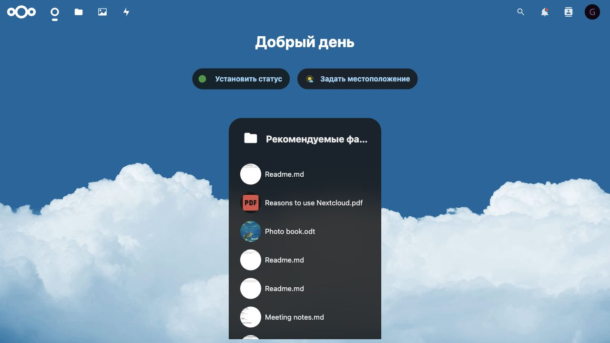
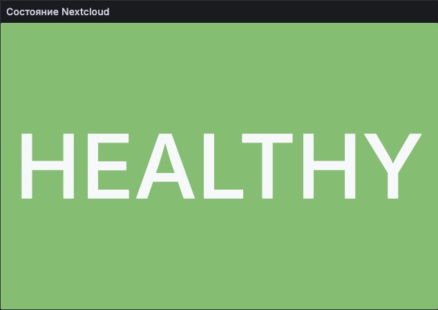
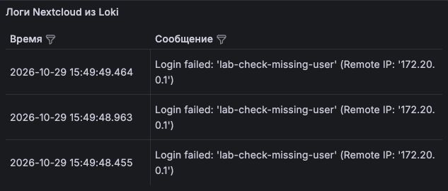
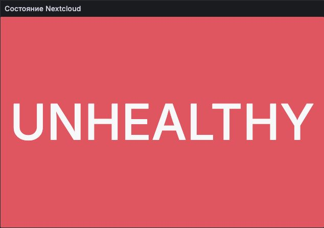
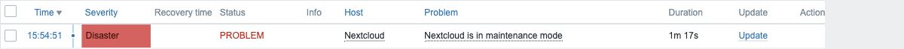
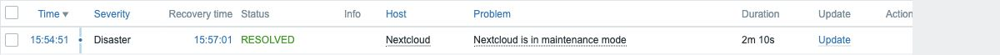

# Лабораторная работа № 1. Loki + Zabbix + Grafana

**Выполнил:** Альмухаметов Г.Р., группа K3360

## Цель работы

Настроить мониторинг и сбор логов Nextcloud, вывести результаты в Grafana.

## 1. Запуск сервисов

Для запуска сервисов подготовлен `docker-compose.yml`, а для сбора логов и мониторинга настроены Promtail, Zabbix и Grafana.

Перед запуском нужно скопировать `.env.example` в `.env` и заполнить пароли.

```bash
docker compose up -d
docker compose ps
```

Запустились семь контейнеров. Адреса веб-интерфейсов:

- Nextcloud: `http://127.0.0.1:8080`;
- Zabbix: `http://127.0.0.1:8082`;
- Grafana: `http://127.0.0.1:3000`.



## 2. Сбор логов

Promtail читает файл `nextcloud.log` из общего с Nextcloud тома и отправляет записи в Loki.

```bash
docker compose logs promtail
```

В логах Promtail появились сообщения `Seeked` и `tail routine: started`. Для проверки выполнены три запроса от несуществующего пользователя. Nextcloud записал ошибки `Login failed`, которые появились в Loki.

## 3. Настройка Zabbix

В разделе **Templates** меню **Data collection** через кнопку **Import** импортирован шаблон `Nextcloud HTTP`. Создан хост `nextcloud` в группе `Applications`, к нему подключён шаблон.

Каждые 10 секунд Zabbix запрашивает `http://nextcloud/status.php` и проверяет поле `maintenance`. Значение `false` преобразуется в `healthy`, значение `true` в `unhealthy`. В обычном режиме получено `healthy`.

## 4. Дашборды Grafana

В Grafana установлен плагин Zabbix 4.6.1 и подключены источники:

- Loki: `http://loki:3100`;
- Zabbix: `http://zabbix-web:8080/api_jsonrpc.php`.

Проверка подключения прошла успешно. Созданы два дашборда. Первый показывает состояние Nextcloud цветной плашкой.



Второй показывает таблицу логов. Проверены запросы:

```logql
{job="nextcloud_logs"}
{job="nextcloud_logs"} | json | level >= 2
{job="nextcloud_logs"} |= "Login failed"
```

Они выводят все записи, предупреждения и ошибки, либо только ошибки входа. Для читаемого текста в таблице добавлен `| json | line_format "{{.message}}"`.



## 5. Проверка режима обслуживания

Включён режим обслуживания:

```bash
docker compose exec -u www-data nextcloud php occ maintenance:mode --on
```

Zabbix получил `unhealthy`, сработал триггер `Nextcloud is in maintenance mode`. Плашка Grafana стала красной.





Затем режим обслуживания выключен:

```bash
docker compose exec -u www-data nextcloud php occ maintenance:mode --off
```

Значение вернулось в `healthy`, плашка стала зелёной. Проблема автоматически получила статус RESOLVED.



## Ответы на вопросы

**Чем SLO отличается от SLA?** SLO задаёт целевое качество сервиса. SLA закрепляет обязательства перед пользователем и последствия их нарушения.

**Чем инкрементальный бэкап отличается от дифференциального?** Инкрементальный сохраняет изменения с последнего бэкапа, дифференциальный с последнего полного.

**В чём разница между мониторингом и observability?** Мониторинг показывает, что возникла проблема. Observability помогает разобраться в её причинах по метрикам, логам и трассировкам.

## Вывод

Настроены сбор логов, мониторинг Nextcloud и два дашборда Grafana. Проверено срабатывание триггера при обслуживании и его автоматическое закрытие после восстановления.
