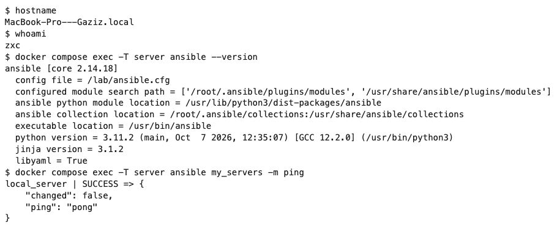
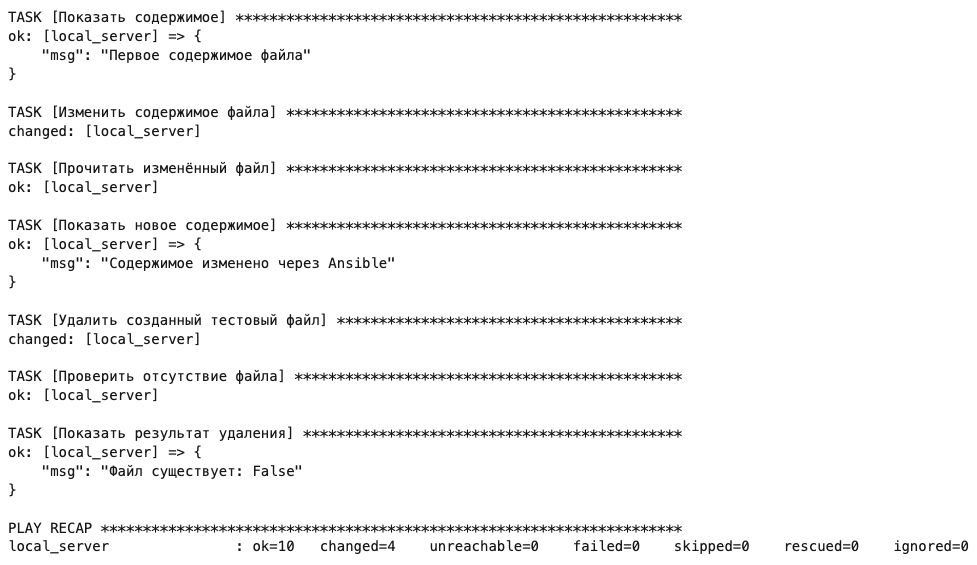
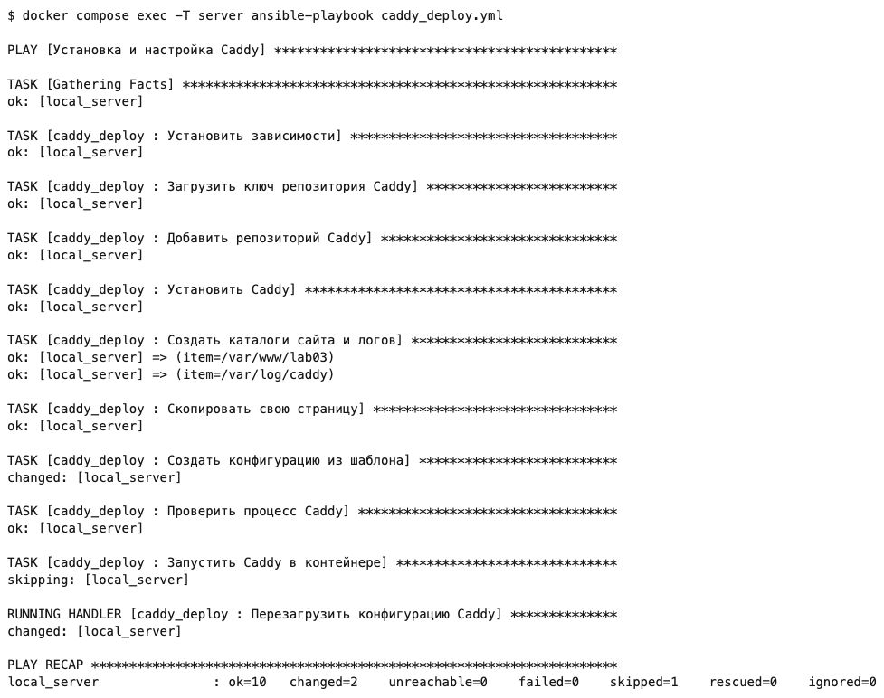
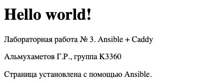
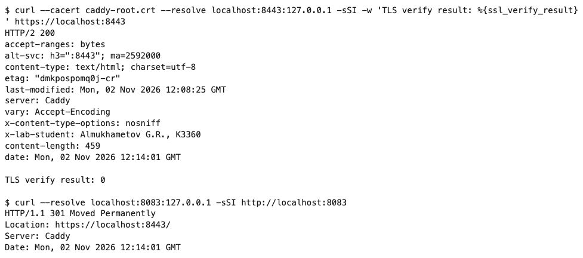

# Лабораторная работа № 3. Ansible + Caddy

**Выполнил:** Альмухаметов Г.Р., группа K3360

## Цель работы

Познакомиться с Ansible, установить Caddy и настроить свою страницу с HTTPS и журналом запросов.

## 1. Подготовка

Работа выполнена локально. Для команд из методички используется Debian 12 в Docker, так как они рассчитаны на Linux.

В [Dockerfile](Dockerfile) установлен Ansible. Файл [ansible.cfg](ansible.cfg) указывает на [inventory/hosts](inventory/hosts), где задано локальное подключение. Запуск среды и проверка связи:

```bash
docker compose up -d --build
docker compose exec server ansible my_servers -m ping
```

Получен ответ `pong`. Установлен Ansible Core 2.14.18.



## 2. Работа с файлом

В [file_operations.yml](file_operations.yml) действия из примера перенесены в плейбук. Он создаёт временный файл, записывает и выводит первый текст, затем меняет содержимое и снова его выводит. В конце файл удаляется, а модуль `stat` проверяет его отсутствие.

```bash
docker compose exec server ansible-playbook file_operations.yml
```

Первый текст: `Первое содержимое файла`. После изменения: `Содержимое изменено через Ansible`. Проверка после удаления вернула `False`. Плейбук завершился без ошибок.



## 3. Установка Caddy

Создана роль [caddy_deploy](roles/caddy_deploy). Она добавляет официальный репозиторий, устанавливает Caddy, копирует `index.html` и создаёт конфигурацию из шаблона `Caddyfile.j2`.

В `vars/main.yml` заданы имя сайта `localhost`, каталог страницы и параметры журнала. При изменении конфигурации обработчик выполняет `caddy reload`. В контейнере нет systemd, поэтому Caddy запускается командой `caddy start`.

```bash
docker compose exec server ansible-playbook caddy_deploy.yml
```

Установлен Caddy 2.11.7. После применения шаблона ошибок нет. Повторный запуск без изменения файлов дал `changed=0` и `failed=0`.



## 4. Своя страница и HTTPS

Вместо стандартной страницы установлена своя с текстом `Hello world!`, ФИО и группой. Она открывается по адресу `https://localhost:8443`.



Для локального HTTPS используется `tls internal`. Caddy сам выпустил сертификат. Это сертификат локального центра, поэтому браузер изначально показывает предупреждение о доверии. Публичный домен в этом варианте не используется.

Проверка с явным указанием корневого сертификата:

```bash
docker compose cp server:/root/.local/share/caddy/pki/authorities/local/root.crt /tmp/lab03-caddy-root.crt
curl --cacert /tmp/lab03-caddy-root.crt -I https://localhost:8443
```

Получен статус `200`, проверка сертификата прошла. Запрос к `http://localhost:8083` перенаправляется на HTTPS с кодом `301`.

Дополнительно настроены заголовки `X-Lab-Student` с фамилией и группой и `X-Content-Type-Options: nosniff`. Они присутствуют в ответе сервера.



## 5. Журнал запросов

Запросы сохраняются в `/var/log/caddy/access.log` в формате JSON с уровнем `INFO`.

```bash
docker compose exec server tail -n 1 /var/log/caddy/access.log
```

После открытия страницы в журнале появился запрос `GET /` со статусом `200`.

Скриншоты вывода команд сделаны с сохранённых результатов, открытых в браузере. Скриншот страницы сделан с работающего Caddy.

## Вывод

Проверена работа Ansible с локальным узлом и тестовым файлом. Через роль установлен Caddy, настроены своя страница, HTTPS, дополнительные заголовки и журнал запросов. Все проверки прошли без ошибок.
